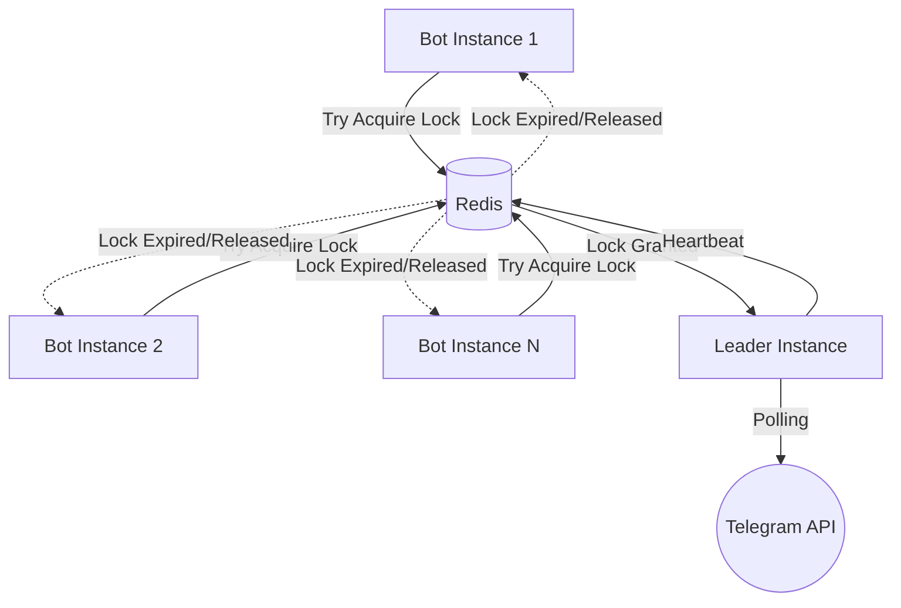

# Chain No Kizuna
> This project is a specialized branch of **[on9wordchainbot](https://github.com/jonowo/on9wordchainbot)** officially created by **[jonowo](https://github.com/jonowo)**.

**Chain No Kizuna** is a high-performance, industry-ready Telegram Word Chain game bot.

[](https://www.python.org/downloads/release/python-3147/)
[](https://github.com/aiogram/aiogram)
[](https://heroku.com/deploy?template=https://github.com/bisug/Chain-No-Kizuna)
[](https://opensource.org/licenses/MIT)

[](https://github.com/bisug/Chain-No-Kizuna/stargazers)
[](https://github.com/bisug/Chain-No-Kizuna/network/members)
[](https://github.com/bisug/Chain-No-Kizuna/issues)
[](https://github.com/bisug/Chain-No-Kizuna/graphs/contributors)
[](https://github.com/bisug/Chain-No-Kizuna)

---

## | Repository Analytics

<p align="center">
  
</p>

---

## | Acknowledgments

This software is built upon the excellent foundation laid by the original creator:

◈ **Original Author and Game Logic**: [jonowo](https://github.com/jonowo)

◈ **Fork Maintainer**: [BisuG](https://github.com/bisug)

All core game mechanics and the initial architecture are credited to the original repository. This fork focuses on modernizing the tech stack (Python 3.14), enhancing cloud deployment (Heroku), and optimizing word engine performance.

---

## | Major Improvements

Compared to the original repository, this fork introduces significant architectural and functional enhancements:

◈ **Modern Tech Stack**: Fully updated to **Python 3.14.7-slim** and **aiogram 3.31.0** for peak performance and long-term support.

◈ **Database & Cache Migration**: 
  - Integrated **MongoDB** for robust global statistics and game archives.
  - Added **Redis** for high-speed session management and High Availability (HA) locking.

◈ **Performance Optimization**: 
  - Implementation of **orjson** for ultra-fast JSON serialization.
  - Full codebase cleanup, removing legacy files and redundant dependencies.

◈ **Cloud & Heroku Ready**: 
  - Native compatibility with **Heroku Workers**.
  - Optimized for 24/7 reliability with built-in leader election.

◈ **Extended Gameplay**: **10 game modes** in total — Classic, Hard Mode, Chaos, Chosen/Random First Letter, Banned/Required Letters, Elimination, Mixed Elimination, and Guess the Word.

◈ **Word List Ships With the Bot**: the dictionary is a committed file, not a runtime download. The accepted word set is fixed by the commit and cannot break because a remote host is down. Rebuild it by hand with `tools/build_wordlist.py`.

◈ **Curated Word Pools**: the bot picks its own words (opening word, Virtual Player replies) from small, everyday-word pools instead of the full 367k list, so it never opens a game on an obscure word. Player input is still validated against the full list, so a pool never narrows the game.

◈ **Test Suite & CI**: 119 stdlib `unittest` tests plus a `ruff` gate run on every push and pull request.

---

## | Table of Contents

◈ [Acknowledgments](#acknowledgments)
◈ [Major Improvements](#major-improvements)
◈ [Features](#features)
◈ [Tech Stack](#tech-stack)
◈ [Architecture](#architecture)
◈ [Project Structure](#project-structure)
◈ [Installation](#installation)
◈ [Word List](#word-list)
◈ [Usage](#usage)
◈ [Configuration](#configuration)
◈ [Customization](#customization)
◈ [Testing](#testing)
◈ [Deployment Guide](#deployment-guide)
◈ [License](#license)

---

## | Features

### Diverse Game Modes

Ten modes, all resolvable by the same `/start<mode>` handler:

◈ **Classic** (`/startclassic`): The standard turn-based experience with strict word validation.

◈ **Hard Mode** (`/starthard`): Reduced timers and stricter length requirements.

◈ **Chaos** (`/startchaos`): High-speed play with randomized turn intervals.

◈ **Chosen First Letter** (`/startcfl`) and **Random First Letter** (`/startrfl`): Fix or randomize the letter the game opens on.

◈ **Banned / Required Letters** (`/startbl`, `/startrl`): Character constraints for advanced difficulty.

◈ **Elimination** (`/startelim`) and **Mixed Elimination** (`/startmelim`): Survival modes where the lowest-scoring players are dropped after each round. Mixed Elimination is a restricted reward, gated to `VIP` users and `VIP_GROUP` chats.

◈ **Guess the Word** (`/startguess`, alias `/new`): Solve a hidden 5-letter word against the bundled puzzle dictionary. Does not need the word-list DAWG.

### Performance & Intelligence

◈ **DAWG Engine**: Uses a *Directed Acyclic Word Graph* for $O(1)$ prefix searching and existence checks, rebuilt in an executor thread so it never blocks the event loop.

◈ **Leader Election**: Integrated support for multiple bot instances; a Redis-based lock (10s TTL, renewed every 5s) ensures only one "Leader" handles Telegram polling at a time.

◈ **State Restoration**: Automatically resumes active games after a restart or crash using persistent Redis session data.

◈ **HTML Native**: Premium UI rendering across all Telegram clients, with dynamic text escaped before it is rendered as HTML.

◈ **Custom Error Reporting**: Unhandled exceptions are logged and reported to the admin group instead of disappearing into the log.

---

## | Tech Stack

◈ **Runtime**: Python 3.14.7 (`requires-python >= 3.14`)

◈ **Package Manager**: [uv](https://docs.astral.sh/uv/) (`uv.lock` is committed; builds use `uv sync --frozen`)

◈ **Framework**: [aiogram 3.31.0](https://github.com/aiogram/aiogram) (Asynchronous Telegram API)

◈ **Dictionary**: [dawg2](https://pypi.org/project/dawg2/) `CompletionDAWG`

◈ **Database**: [MongoDB](https://www.mongodb.com/) via `pymongo`'s async client (Stats & Archives)

◈ **Cache**: [Redis](https://redis.io/) via `redis-py` asyncio (Session Management & HA Locks)

◈ **Optimization**: `orjson` for serialization, `aiofiles` for the word-list load, `psutil` for the `/ping` runtime report

◈ **Tests**: stdlib `unittest`; `ruff` (F, E9 rules) as the lint gate

---

## | Architecture

The bot is designed for **High Availability (HA)**. It uses a Redis-based leader election mechanism to ensure that even if multiple bot instances are running (e.g., in a scaled Heroku cluster), only one "Leader" processes Telegram updates.



◈ **Leader Election**: Controlled by `chainnokizuna/services/leader.py`.
◈ **Persistence**: Game states are synced to Redis/MongoDB, allowing a new leader to resume active matches instantly.

---

## | Project Structure

```text
Chain-No-Kizuna/
├── chainnokizuna/
│   ├── handlers/            # Telegram command & message handlers
│   │   ├── gameplay.py      # Core mechanics (start, join, flee, end, VP)
│   │   ├── info.py          # Help, game info, ping, run info, chat id
│   │   ├── misc.py          # Maintenance mode, feedback, leave, db status
│   │   ├── stats.py         # Player, group, and global statistics
│   │   ├── wordlist.py      # Dictionary & DAWG word management
│   │   └── errors.py        # Global exception handler & admin reporting
│   ├── core/resources.py    # Bot, Mongo, Redis clients & global state
│   ├── db/redis.py          # Game state persistence & restoration
│   ├── models/              # Game logic & player data structures
│   │   ├── game/            # Ten game variants, one module each
│   │   │   ├── banned_letters.py
│   │   │   ├── chaos.py
│   │   │   ├── chosen_first_letter.py
│   │   │   ├── classic.py
│   │   │   ├── elimination.py
│   │   │   ├── guess_the_word.py
│   │   │   ├── hard_mode.py
│   │   │   ├── mixed_elimination.py
│   │   │   ├── random_first_letter.py
│   │   │   └── required_letter.py
│   │   └── player.py        # Player state & session management
│   ├── services/            # Infrastructure services
│   │   ├── leader.py        # Redis-based High Availability lock
│   │   └── words.py         # DAWG Engine, word pools & word validation
│   ├── utils/               # Shared helper functions
│   │   ├── commands.py      # Telegram command-menu publication
│   │   ├── decorators.py    # Private-only / group-only command guards
│   │   ├── keyboards.py     # Keyboard & UI builders
│   │   ├── telegram.py      # Admin-group reporting helpers
│   │   └── timer.py         # Asynchronous game timers
│   ├── filters.py           # Owner / admin / has-game / main-bot filters
│   ├── data/                # Bundled word data
│   │   ├── wordlist.txt     # Full dictionary the bot validates against
│   │   ├── commonwords.json # Curated everyday words for the bot's own picks
│   │   ├── fiveletters.json # All 5-letter words
│   │   ├── all-five.json        # 5-letter answer set (Guess the Word)
│   │   └── commonfiveletterwords.json  # 5-letter words with meanings
│   └── __main__.py          # Application entry point
├── tests/                   # stdlib unittest suite (119 tests)
├── tools/build_wordlist.py  # Rebuilds data/wordlist.txt from upstream sources
├── config.py                # Global settings & game balance
├── LICENSE                  # MIT License file
├── Dockerfile               # Containerization manifest (multi-stage, non-root)
├── .dockerignore            # Files excluded from Docker builds
├── .gitignore               # Files excluded from Git versioning
├── app.json                 # Heroku deployment manifest
├── heroku.yml               # Heroku container (Docker) deployment
├── Procfile                 # Heroku process configuration
├── pyproject.toml           # Project metadata & pinned dependencies
├── uv.lock                  # Pinned dependency lockfile (required by `uv sync --frozen`)
├── .python-version          # Pinned CPython version (3.14.7) for uv
├── .env.template            # Environment variable template
└── .github/
    ├── dependabot.yml       # Weekly uv lockfile updates
    └── workflows/           # CI: tests.yml (unittest + ruff), security scan

## | Frameworks & Tools

<p align="left">
  
  
  
  
  
  
</p>

---

## | Contributors

This project exists thanks to all the people who contribute.

<a href="https://github.com/bisug/Chain-No-Kizuna/graphs/contributors">
  
</a>

◈ **Maintainer**: [BisuG](https://github.com/bisug)

◈ **Original Author**: [jonowo](https://github.com/jonowo)

---

## | Installation

### Local Setup

1. **Clone the Repository**:
   ```bash
   git clone https://github.com/bisug/Chain-No-Kizuna.git
   cd Chain-No-Kizuna
   ```

2. **Install Dependencies** (Python 3.14 required):
   ```bash
   pip install uv
   uv sync --frozen   # installs into .venv/ from the committed uv.lock
   ```
   ◈ *`uv sync` creates and uses `.venv/` automatically, so there is no separate `venv`
   activation step. Use `uv run <command>` to execute inside that environment.*

3. **Configure Settings**:
   ```bash
   cp .env.template .env
   # Edit .env and fill in the variables obtained from the Configuration section.
   ```

4. **Run the Bot**:
   ```bash
   uv run python -m chainnokizuna
   ```

◈ **Note**: `TOKEN`, `MONGO_URI`, `REDIS_URL`, and `OWNER_ID` have no in-code defaults. The bot refuses to start if any of them is missing, rather than falling back to a hardcoded value.

---

## | Word List

The dictionary is **committed to the repository** (`chainnokizuna/data/wordlist.txt`, ~367,000 words, one lowercase word per line) instead of being downloaded at startup. The accepted word set is therefore fixed by the commit and cannot fail because a remote host is down or changes under the bot.

◈ **`wordlist.txt`** — the authority on what counts as a real word. All player input is validated against it.

◈ **`commonwords.json`** (9,533 words) / **`fiveletters.json`** (14,240 words) — curated pools used only for words the *bot* chooses for itself (the opening word and Virtual Player replies). The full list stays the validator, so a pool can never make a legitimate word "not in my list of words".

◈ **`all-five.json`** (23,829 words) / **`commonfiveletterwords.json`** (2,318 words) — the Guess the Word puzzle set, which runs on its own files instead of the DAWG.

### Rebuilding the list

```bash
uv run python tools/build_wordlist.py
```

The script fetches its upstream sources, strips proper nouns that no other dictionary endorses, adds the inflections the headword list is missing, rebuilds the two pools from the cleaned list, and then verifies the result against a real `CompletionDAWG` (including checking that `aaron` and `aberdeen` are gone and `email` survived) before writing anything.

---

## | Usage

Once the bot is running, add it to a Telegram group and use the following commands:

### ◈ 1. Game Initiation
Use these commands to start a specific game variant.

| Command | Variant | Description |
| :--- | :--- | :--- |
| `/startclassic` | Classic | Standard word chain game. Also aliased as `/startgame`. |
| `/starthard` | Hard Mode | Reduced timers and stricter limits. |
| `/startchaos` | Chaos | Randomized intervals and high-speed play. |
| `/startcfl` | Chosen First | Pick the starting letter of the match. |
| `/startrfl` | Random First | Bot picks a random starting letter. |
| `/startbl` | Banned Letters | Prevents using specific characters. |
| `/startrl` | Required Letter | Forces the use of a specific character. |
| `/startelim` | Elimination | Players with the lowest scores are removed each round. |
| `/startmelim` | Mixed Elim | Elimination with a restricted reward; needs `VIP` or `VIP_GROUP`. |
| `/startguess` | Guess Word | Solve the hidden 5-letter word. |
| `/new` | (Alias) | Shortcut for Guess the Word mode. |

◈ **Note**: Any `/start<mode>` command not in this list is answered with "Unknown game mode", and dictionary-backed modes refuse to start if the word list failed to load.

### ◈ 2. Gameplay Actions
Active controls for players currently in a match.

| Command | Description |
| :--- | :--- |
| `/join` | Join the entry phase of a match (group chats only). |
| `/flee` | Voluntarily leave an active match. |
| `/extend` | Add 30 seconds to the joining phase. Each player may extend once; admins can pass a signed number of seconds. |
| `/addvp` | Add a Virtual Player, if `VP_TOKEN` is configured. Players in the match, admins, and the owner may do this. |
| `/remvp` | Remove the Virtual Player. |
| `/stats` | View your detailed stats (Aliases: `/stat`, `/stalk`). |
| `/top` | View global leaderboard (Aliases: `/leaderboard`, `/topseekers`). |

### ◈ 3. Information & Support
General utility commands for users.

| Command | Description |
| :--- | :--- |
| `/help` | Display the main help menu. |
| `/gameinfo` | Detailed documentation on every game mode. |
| `/ping` | Check bot latency and cluster health. |
| `/runinfo` | View current bot instance and leadership status. |
| `/groupstats` | Show metrics for the current group only. |
| `/globalstats` | Show aggregate lifetime bot metrics. |
| `/feedback` | Send a report or message to the developer. |
| `/troubleshoot` | Common fixes for bot issues. |
| `/chatid` | Get the numeric ID of the current chat. |

### ◈ 4. Word Dictionary
Commands for interacting with the DAWG engine.

| Command | Description |
| :--- | :--- |
| `/exists <word>` | Query if a word is in the dictionary (Alias: `/exist`). |
| `/reqaddword` | Request a new word addition (Alias: `/reqaddwords`). |

### ◈ 5. Administrative Control
Access is enforced by the bot: `Owner` matches only `OWNER_ID`, `Admin` matches the owner or a Telegram chat admin of the current group.

| Command | Access | Description |
| :--- | :--- | :--- |
| `/end` | Admin | Terminate the game in the current group. |
| `/forcestart` | Admin | Skip the rest of the joining phase. |
| `/forceskip` | Owner | Force-skip the current player's turn. |
| `/forcejoin` | Owner | Force-add a user to the match. |
| `/forceflee` | Owner | Force-remove a user from the match. |
| `/killgame` | Owner | Emergency stop for all games (Alias: `/killgaym`). |
| `/maintmode` | Owner | Toggle global maintenance/update mode. |
| `/addword` | Owner | Add a word to the DAWG (Alias: `/addwords`). |
| `/rejword` | Owner | Reject a pending word addition. |
| `/leave` | Owner | Force the bot to leave the group. |
| `/db` | Owner | Inspect MongoDB/Redis status (Alias: `/mongo`). |
| `/playinggroups` | Owner | List all currently active matches globally. |

---

## | Configuration

The bot is configured entirely via environment variables. Create a `.env` file in the root directory or set these in your hosting provider's dashboard (e.g., Heroku Config Vars).

### ◈ Environment Variables Summary

| Variable | Description | Required | Default |
| :--- | :--- | :---: | :--- |
| `TOKEN` | Main Telegram Bot Token from [@BotFather](https://t.me/BotFather) | Yes | - |
| `MONGO_URI` | MongoDB Connection URI (Atlas or Local). `MONGODB_URI` is accepted as an alias | Yes | - |
| `REDIS_URL` | Redis/Valkey Connection URL (Upstash/Cloud) | Yes | - |
| `OWNER_ID` | Your numeric Telegram User ID | Yes | - |
| `VP_TOKEN` | Virtual Player (AI) Bot Token | No | - |
| `DB_NAME` | Name of the MongoDB database | No | `WordChainDB` |
| `ADMIN_GROUP_ID` | Group ID for administrative reports/logs | No | `0` (Disabled) |
| `OFFICIAL_GROUP_ID` | ID of your community's official game group | No | `0` |
| `WORD_ADDITION_CHANNEL_ID` | Channel ID for word addition announcements | No | `0` (Disabled) |
| `LOG_LEVEL` | Logging verbosity (DEBUG, INFO, WARNING, ERROR, CRITICAL) | No | `INFO` |
| `SUPPORT_GROUP` | Username of your Support Group (no @) | No | `SuMelodyVibes` |
| `UPDATE_CHANNEL` | Username of your Update Channel (no @) | No | `SuMelodyVibes` |
| `VIP` | List of VIP player user IDs (Comma-separated) | No | `[]` |
| `VIP_GROUP` | List of VIP group chat IDs (Comma-separated) | No | `[]` |

---

### ◈ Detailed Setup Guides

#### 1. Obtaining a Telegram Bot Token
1. Start a chat with **[@BotFather](https://t.me/BotFather)** on Telegram.
2. Send `/newbot` and follow the naming instructions.
3. Copy the **HTTP API Token** provided. This is your `TOKEN`.

#### 2. Setting up MongoDB Atlas
1. **Register**: Sign up at [MongoDB Atlas](https://www.mongodb.com/cloud/atlas).
2. **Cluster**: Create a free **M0 Shared Cluster**.
3. **Database User**: Create a user with **Password Authentication** and **Read/Write** access.
4. **Network Access**: Add IP `0.0.0.0/0` (Allow Access from Anywhere) for cloud hosting compatibility.
5. **Connect**: Select **Connect** ➜ **Drivers** ➜ **Python** and copy the URI. 
   ◈ *Replace `<password>` with your created user's password.*

#### 3. Setting up Redis (Upstash)
1. Visit [Upstash](https://upstash.com/) and create a free Redis database.
2. Under the **Details** tab, find the **REST API** or **Redis Connect** section.
3. Copy the `redis://...` URL. This is your `REDIS_URL`.

#### 4. Finding Your Telegram ID
1. Message **[@userinfobot](https://t.me/userinfobot)** and send any text.
2. It will reply with your numeric **Id**. This is your `OWNER_ID`.

---

## | Customization

You can fine-tune the bot's behavior by modifying the `GameSettings` class in `config.py`. This is ideal for balancing the game's difficulty and pacing.

| Setting | Description | Default |
| :--- | :--- | :--- |
| **Joining phase** | | |
| `JOINING_PHASE_SECONDS` | Time players have to `/join`. | `60` |
| `MAX_JOINING_PHASE_SECONDS` | Ceiling on the phase after `/extend` calls. | `180` |
| `JOINING_PHASE_WARNINGS` | Remaining seconds at which a countdown warning is sent. | `(15, 30, 60)` |
| **Room size** | | |
| `MIN_PLAYERS` | Minimum players needed to start a game. | `2` |
| `MAX_PLAYERS` | Maximum players allowed in a standard room. | `50` |
| **Turn timer** | | |
| `MIN_TURN_SECONDS` | Fastest possible turn timer (Hard Mode). | `20` |
| `MAX_TURN_SECONDS` | Slowest possible turn timer (Classic). | `40` |
| `TURN_SECONDS_REDUCTION_PER_LIMIT_CHANGE` | Seconds shaved from the timer each time the word-length limit rises. | `5` |
| **Word length** | | |
| `MIN_WORD_LENGTH_LIMIT` | Starting minimum length for a player's word. | `3` |
| `MAX_WORD_LENGTH_LIMIT` | Highest the limit can be raised to during a game. | `10` |
| `WORD_LENGTH_LIMIT_INCREASE_PER_LIMIT_CHANGE` | How much the minimum length grows per change. | `1` |
| `TURNS_BETWEEN_LIMITS_CHANGE` | Turns between difficulty increases. | `5` |
| `MAX_STARTING_WORD_LENGTH` | Longest word a game may open with. | `12` |
| **Elimination modes** | | |
| `ELIM_JOINING_PHASE_SECONDS` | Joining phase for elimination games. | `90` |
| `ELIM_MIN_PLAYERS` | Minimum players to start an elimination game. | `5` |
| `ELIM_MAX_PLAYERS` | Maximum players in an elimination game. | `30` |
| `ELIM_TURN_SECONDS` | Turn timer for elimination games. | `30` |
| `ELIM_MAX_TURN_SCORE` | Cap on a single turn's score. | `20` |

◈ **Note**: After changing these values, a restart of the bot instance is required to apply the new settings. Games restored from Redis keep the values captured when they were created, so let existing matches finish before restarting with new balance.

---

## | Testing

The suite is stdlib `unittest` — no test framework dependency to install. It covers the config parser, the error handler, game state round-trips through Redis serialization, the leader election, startup cleanup, the Guess the Word mode, and the word-list/pool loading.

`config.py` reads its secrets at import time, so the four required variables must be present for the suite to run. They are placeholders and are never sent to Telegram.

```bash
uv sync --frozen
TOKEN=123456789:CIplaceholderTOKEN000000000000000 \
MONGO_URI=mongodb://127.0.0.1:27017 \
REDIS_URL=redis://localhost:6379/0 \
OWNER_ID=1 \
uv run --no-sync python -m unittest discover -s tests -t . -v
```

◈ **Live Redis**: `tests/test_leader.py` includes one test that needs a real Redis server. It is skipped unless `RUN_REDIS_TESTS=1` is set. Export that variable to include it, as `.github/workflows/tests.yml` does (it starts a `redis:8-alpine` service container).

◈ **Lint**: the CI gate is `ruff` restricted to real errors, not style:

```bash
uvx ruff@latest check --no-cache --select F,E9 chainnokizuna config.py tests
```

---

## | Deployment Guide

### Option 1: Heroku (Recommended)

#### ◈ Mode A: One-Click (Easiest)
Simply click the button below and fill in the environment variables:

[](https://heroku.com/deploy?template=https://github.com/bisug/Chain-No-Kizuna)

#### ◈ Mode B: Manual GitHub Connection
1. **Fork** this repository to your own GitHub account.
2. Go to your [Heroku Dashboard](https://dashboard.heroku.com/apps) and create a new App.
3. In the **Deploy** tab, select **GitHub** as the deployment method.
4. Search for your forked `Chain-No-Kizuna` repo and click **Connect**.
5. Enable **Automatic Deploys** if desired.
6. Go to **Settings** ➜ **Reveal Config Vars** and add all variables obtained above.
7. Manual Deploy the `main` branch once to trigger the initial build.

---

### Option 2: Virtual Private Server (VPS)

For 24/7 reliability on Ubuntu/Debian, use `systemd`:

1. **Install Dependencies**:
   ```bash
   sudo apt update && sudo apt install python3-pip python3-venv redis-server -y
   # MongoDB is also required: use a local mongod, a Docker container, or a remote Atlas cluster.
   ```

2. **Setup Project**:
   ```bash
   git clone https://github.com/bisug/Chain-No-Kizuna.git && cd Chain-No-Kizuna
   pip install --user uv
   uv sync --frozen
   cp .env.template .env # Fill with variables from the Configuration section
   ```

3. **Create Service File**:
   `sudo nano /etc/systemd/system/chainbot.service`
   ```ini
   [Unit]
   Description=Chain No Kizuna Bot
   After=network.target

   [Service]
   WorkingDirectory=/home/youruser/Chain-No-Kizuna
   ExecStart=/home/youruser/Chain-No-Kizuna/.venv/bin/python -m chainnokizuna
   EnvironmentFile=/home/youruser/Chain-No-Kizuna/.env
   Restart=always

   [Install]
   WantedBy=multi-user.target
   ```

   ◈ *`uv sync` builds the environment in `.venv/`, so `ExecStart` points at
   `.venv/bin/python` — not a `venv/` directory created by hand.*

4. **Start Service**:
   ```bash
   sudo systemctl enable chainbot
   sudo systemctl start chainbot
   ```

---

### Option 3: Docker (Orchestrated)

1. **Build Image**:
   ```bash
   docker build -t chainnokizuna .
   ```

2. **Run Container**:
   ```bash
   docker run -d \
     --name chainbot \
     --env-file .env \
     --restart unless-stopped \
     chainnokizuna
   ```

◈ **Note**: Ensure your `REDIS_URL` and `MONGO_URI` point to accessible instances (e.g., using `host.docker.internal` or external cloud URLs).

◈ The image is multi-stage: dependencies are installed with `uv sync --frozen` in a builder stage, and the runtime stage runs as the unprivileged `kizuna` user with the CPython JIT enabled.

◈ **Compose tip**: give the container `--add-host=host.docker.internal:host-gateway` (or the equivalent on your platform) so `MONGO_URI` and `REDIS_URL` can reach services running on the Docker host.

---

## | Platform Compatibility & Support

This repository has been definitively **tested and verified on Heroku**. While it contains configurations for VPS and Docker, it has not been extensively validated across all possible hosting environments.

◈ **Reporting Issues**: If you encounter bugs or deployment failures on other platforms, please raise a detailed issue in the [GitHub Issues](https://github.com/bisug/Chain-No-Kizuna/issues) section.

◈ **Developer Support**: For immediate assistance or community discussion, contact me via the [Support Group](https://t.me/SuMelodyVibes).

---

## | License

This project is licensed under the **MIT License**. See the `LICENSE` file for details.

---

> **Support**: Visit [@SuMelodyVibes](https://t.me/SuMelodyVibes) for official updates and developer support.